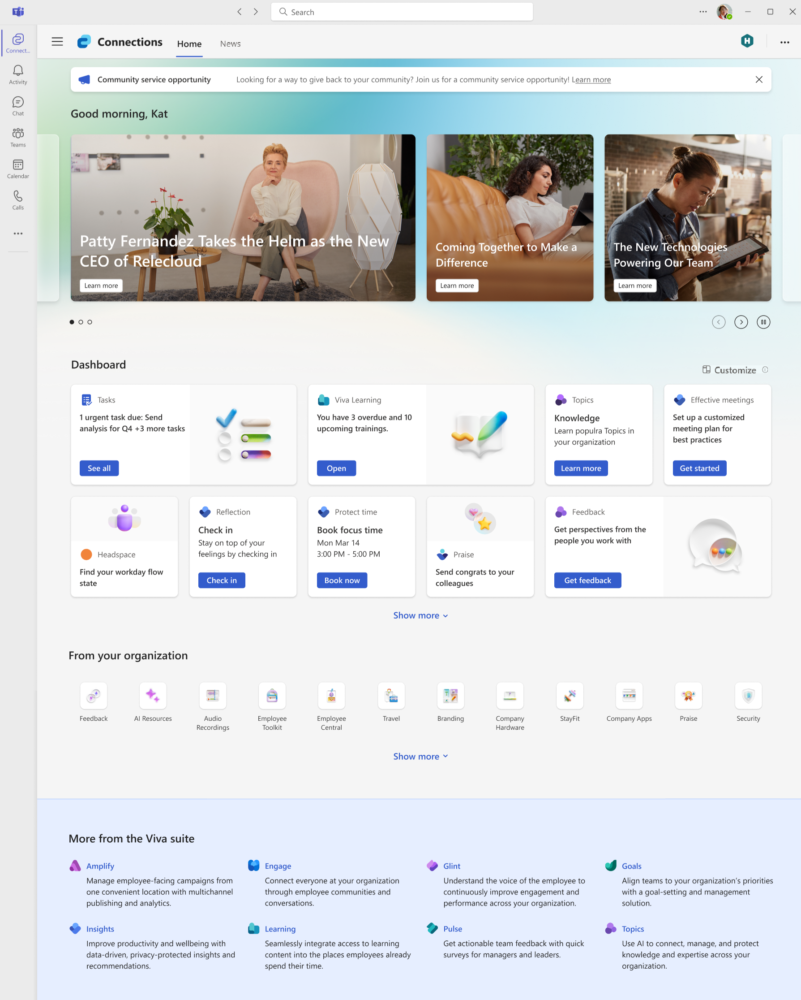
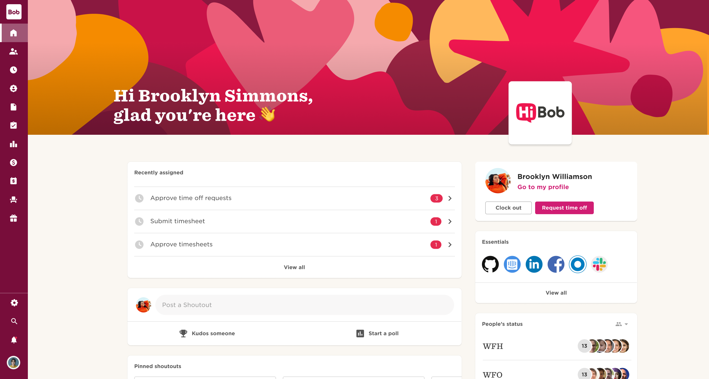
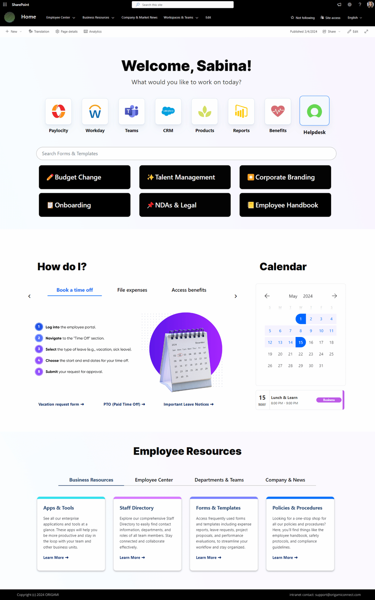
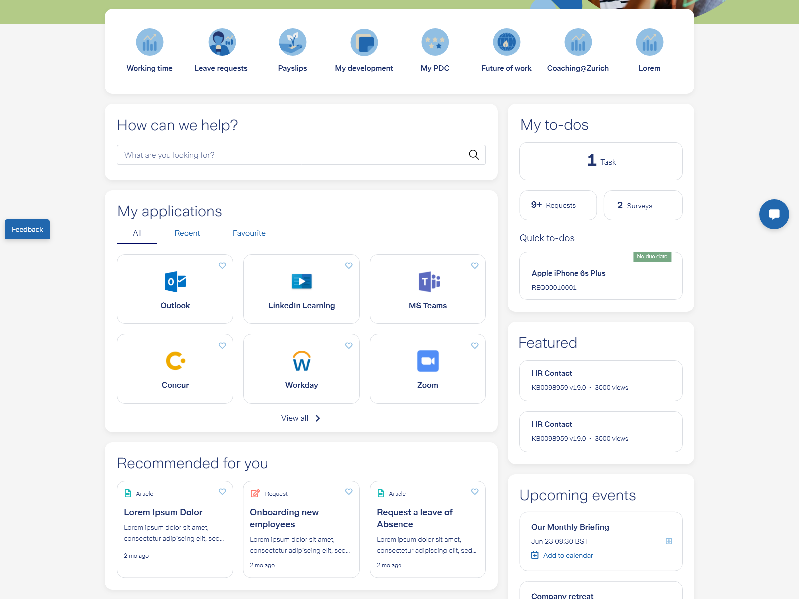
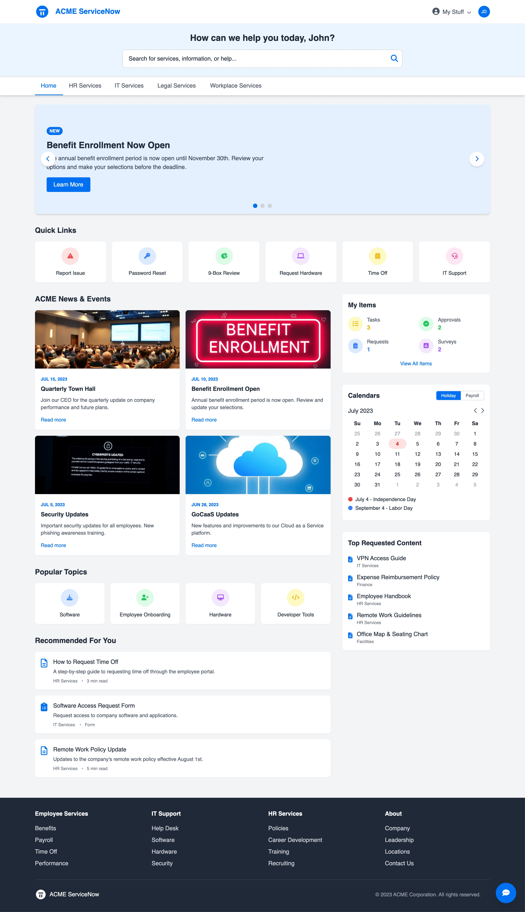
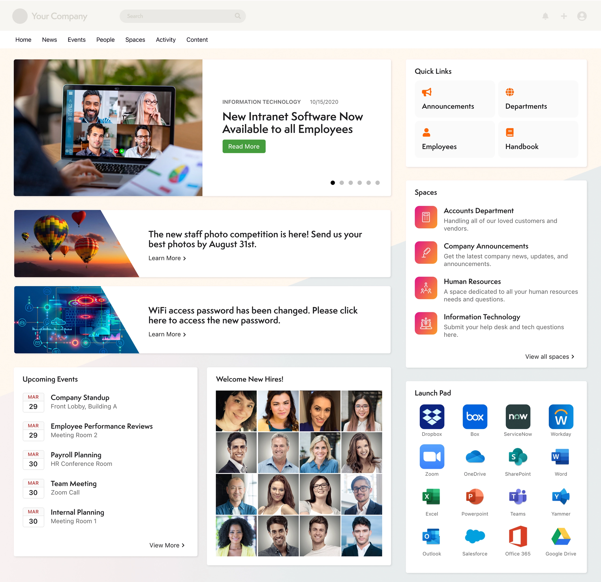

# Employee Home Dashboard — Claude Implementation Brief

Design and implement a modern employee home dashboard for our company management system.

This is the landing page every employee sees after signing in. It should feel like a polished employee operating system: personalized, calm, useful, aesthetic, and interactive. It must not resemble a generic analytics-heavy admin template.

## Before implementation

1. Inspect the existing project structure, design system, reusable components, theme tokens, routing, and data patterns.
2. Read the relevant product and architecture documents before proposing changes.
3. Preserve existing conventions and functionality.
4. Reuse existing components where appropriate.
5. Present a brief implementation plan before changing code.
6. Do not add large dependencies unless clearly justified.

## Primary user questions

The dashboard should immediately answer:

- What needs my attention?
- What is happening today?
- What changed in the company?
- Which apps and resources do I use most?
- How can I quickly find a person, policy, form, or service?

## Page structure

### Header

- Personalized greeting such as “Good morning, Rishi”.
- Current date and a short contextual message.
- Prominent global search or command bar.
- Notifications and user profile controls.
- Search should cover apps, people, policies, forms, announcements, and services.

### Needs your attention

Create a high-priority actionable area for pending approvals, assigned work, overdue training, expense or leave requests, documents awaiting signature, and IT or HR requests.

Each item should show its type, title, urgency or due date, and a clear action. Allow simple actions to be completed without leaving the dashboard where practical. Urgent items should stand out without making the entire interface feel alarming.

### App launcher

Provide an attractive launcher for frequently used company tools such as HR, Projects, Finance, CRM, attendance, documents, IT support, learning, and the company directory.

Support pinned or favorite apps, recently used apps, recognizable icons, polished hover states, and a “View all apps” action.

### Today

Show a compact daily overview of meetings, events, deadlines, reminders, and availability. Keep it scannable rather than reproducing a complete calendar application.

### Company pulse

Include one prominent company announcement, personalized company news, policy or operational updates, and an acknowledgement state for mandatory announcements when applicable. Use editorial cards and strong hierarchy instead of a dense list.

### People and culture

Include a compact, warm area for new joiners, birthdays, work anniversaries, recognition, kudos, and upcoming company events. This should humanize the dashboard without overpowering work-related content.

### Quick actions

Provide shortcuts for actions such as requesting leave, submitting an expense, creating a support ticket, booking a room, finding a colleague, viewing a payslip, and giving recognition.

## Visual direction

Combine:

- Microsoft Viva Connections’ information architecture.
- Rippling-style app launching.
- SAP Work Zone-style actionable task cards.
- ServiceNow Employee Center’s universal search and self-service model.
- HiBob’s warmth and company-culture features.
- Linear’s typography, restrained color, spacing, density, and interaction polish.

Use a refined bento-style grid, clear hierarchy, efficient spacing, soft neutral surfaces, one restrained brand accent, subtle borders and shadows, medium corner radii, purposeful icons, and polished empty/loading/hover/focus/success/error states.

Avoid generic admin-template styling, a wall of equally weighted cards, excessive gradients or glassmorphism, oversized KPI charts, too many colors, decorative clutter, and important actions hidden behind multiple clicks.

## Interaction and accessibility

- Make the page role-aware and personalized.
- Prioritize urgent items, then daily work, then company content.
- Support app pinning or reordering if the architecture permits it.
- Use progressive disclosure for secondary information.
- Consider a Cmd/Ctrl+K command palette.
- Ensure excellent desktop, tablet, and mobile behavior.
- Meet WCAG expectations for contrast, semantics, keyboard operation, focus treatment, and reduced motion.

## Engineering expectations

- Use real APIs when available and realistic mock data only when necessary.
- Keep mock data separate from presentation components.
- Create reusable dashboard section and card components.
- Do not hardcode the current employee’s identity throughout the UI.
- Preserve API contracts, authentication, authorization, and organization scoping.
- Clearly identify mocked or deferred backend functionality.
- Keep the implementation maintainable and aligned with the existing codebase.

## Expected result

Deliver a production-quality dashboard rather than a static mockup. It should feel cohesive and intentional, with realistic content, meaningful interactions, and strong responsive behavior.

After implementation:

1. Run the relevant checks and tests.
2. Review the page at desktop, tablet, and mobile sizes.
3. Fix overflow, inconsistent spacing, weak hierarchy, and accessibility issues.
4. Summarize files changed, design decisions, mocked functionality, and remaining integration work.

## Local visual references

Use these for layout principles, hierarchy, visual tone, and interaction ideas. Do not reproduce any design literally.

### 1. Microsoft Viva Connections

Useful for personalized information architecture, announcements, actionable cards, news, and resources.

### 2. HiBob employee dashboard

Useful for its warm greeting, human tone, assigned actions, employee status, and self-service shortcuts.

### 3. Modern employee homepage

Useful for app shortcuts, prominent search, forms, calendar, and resource organization.

### 4. Zurich Employee Center

Useful for navigation, app launching, personalized to-dos, employee services, and content grouping.

### 5. ServiceNow Employee Center

Useful for universal search, announcements, quick actions, personal items, and self-service content.

### 6. Employee app launchpad

Useful for company news, events, people, quick links, and a large integrated application launcher.

